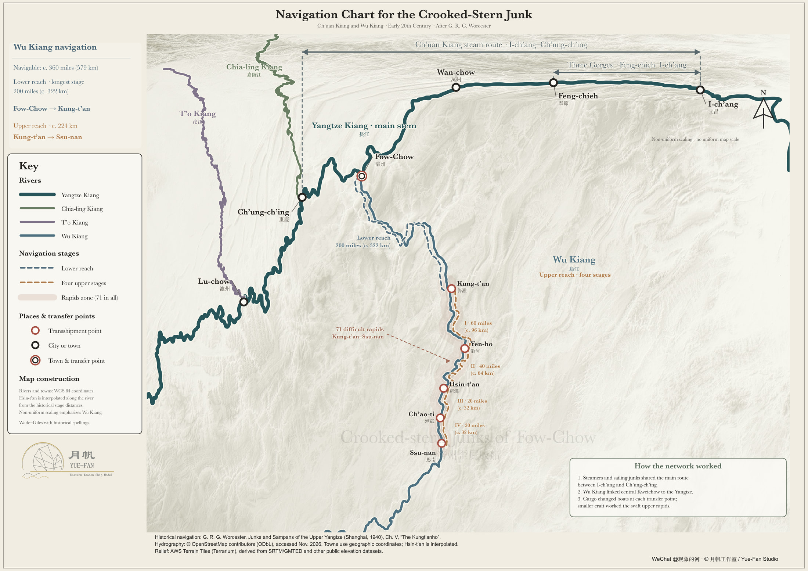
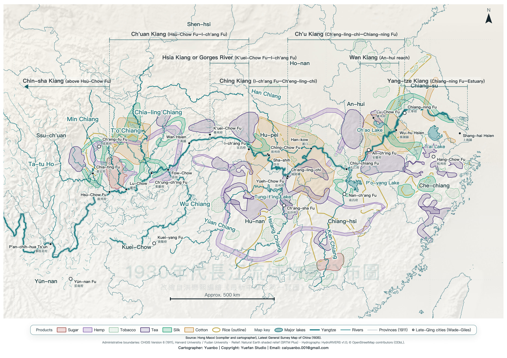
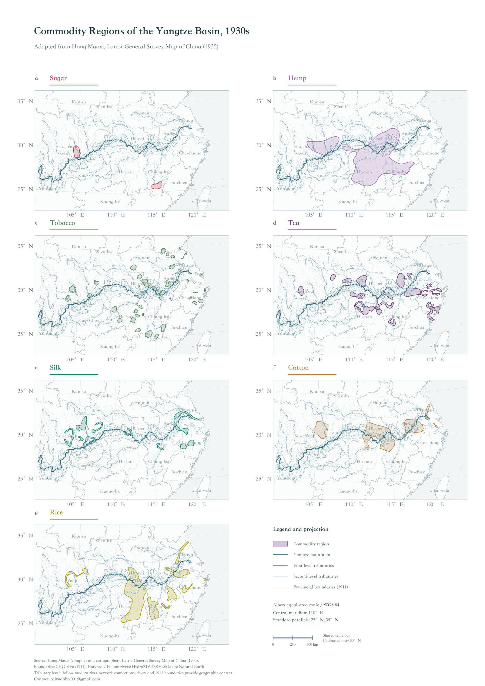
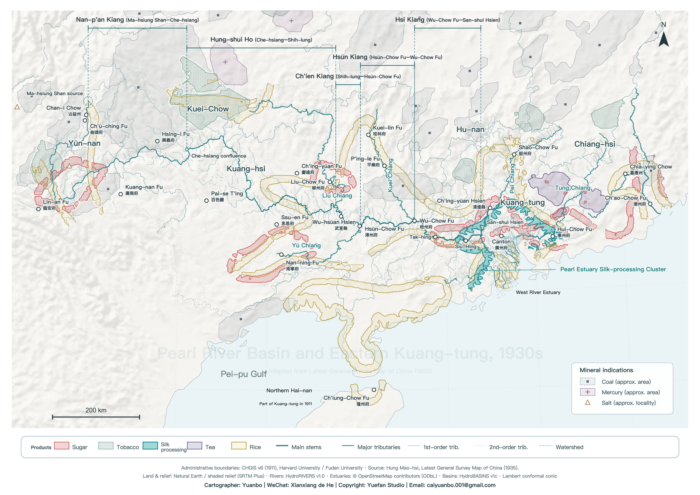
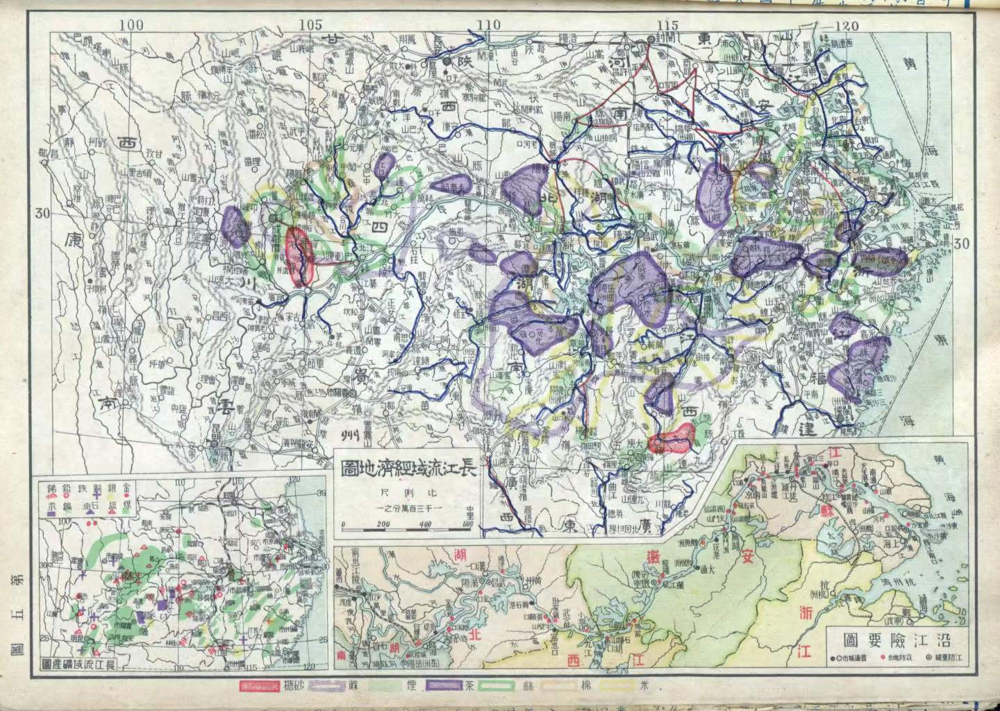
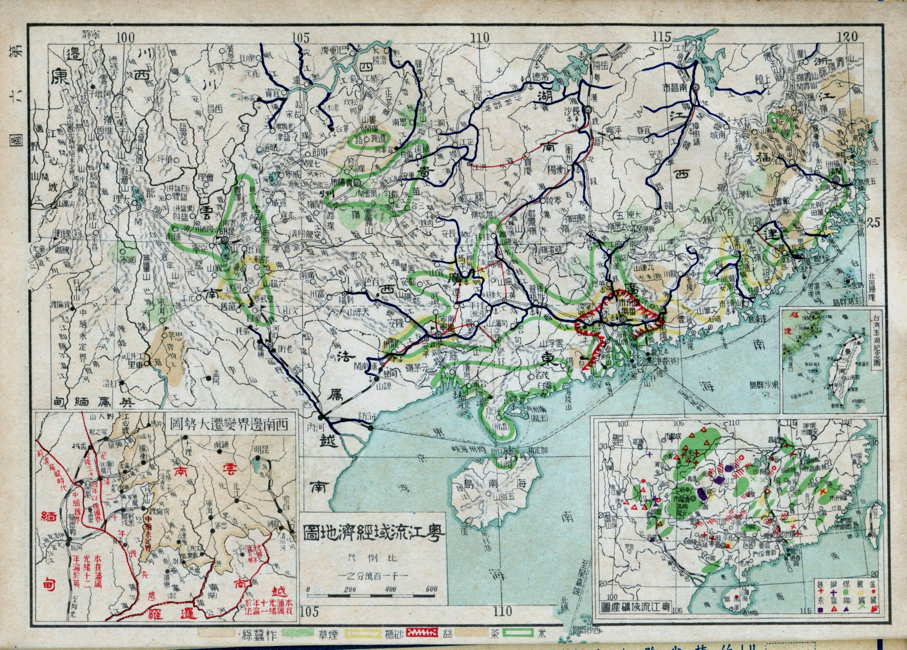

# The Crooked-Stern Junk

### Rivers, commodities, and port networks in historical China

**Historical cartography · Inland navigation · Research in progress**

[Navigation chart](#01--a-vessel-and-its-river) · [Commodity maps](#02--commodities-and-waterways) · [Historical sources](#03--from-source-map-to-reconstruction) · [Research notes](#04--reading-the-network)

---

How do a boat’s hull, a difficult river reach, and a port’s trading role fit together?

This project begins with the **crooked-stern junk of Fow-Chow (涪州)** and the Wu Kiang, then follows the connections between navigational conditions, vessel types, transshipment, commodities, and wider trade networks. Historical maps and textual evidence are read alongside modern cartographic reconstructions.

The material is presented in three distinct forms: **historical reproductions**, **reconstructed maps**, and **interpretive research notes**. Each serves a different purpose; a clean modern map does not make its historical evidence more precise.

## 01 · A vessel and its river

**Navigation Chart for the Crooked-Stern Junk**  
*Ch’uan Kiang and Wu Kiang · Early 20th Century · After G. R. G. Worcester*

The chart brings the Wu Kiang’s staged transport system into focus. Fow-Chow connects the tributary with the Yangtze; Kung-t’an marks a major interruption in continuous navigation; four upper stages lead toward Ssu-nan. The historical account assigns **71 difficult rapids to the Kung-t’an–Ssu-nan reach as a whole**.

The map uses real river geometry and elevation data, with non-uniform scaling to emphasize the Wu Kiang. **Hsin-t’an is an interpolated historical position**, rather than a confirmed modern coordinate. The shaded rapids corridor does not locate 71 individual rapids.

[View / download the full chart · PNG, 400 DPI](歪屁股船英文_川江乌江航运体系_真实GIS版_EN_v10_400DPI.png) · [Read the chart’s sources and spatial caveats](SOURCES.md#navigation-chart)

## 02 · Commodities and waterways

### The Yangtze basin

The reconstruction places the source map’s commodity regions beside a legible river network and historical place labels. Sugar, hemp, tobacco, tea, silk, cotton, and rice can be read in relation to the main stem, tributaries, and lake systems.

[Full-resolution map · JPG](Yangtze_Products_1930s_EN_HighRes15MB.jpg) · [Historical reproduction](长江流域物产_原件.jpg)

<strong>Compare the seven commodities separately</strong> — open the thematic sheet

Separating the commodity regions makes overlaps easier to inspect. The seven-panel sheet is a companion to the main map, not an independent source.

[Download the full thematic sheet · PNG, 600 DPI](yangtze_seven_panels_hydro_EN_600dpi.png)

### The Pearl River basin and eastern Kuang-tung

The second basin offers a comparative view of commodity regions and waterways across southern China. Its source, symbol system, and geographical coverage should be read on their own terms rather than treated as identical to the Yangtze map.

[Full-resolution map · PNG](Pearl_River_Eastern_Kuangtung_EN_HighRes.png) · [Historical reproduction](粤江流域物产_原件.jpg)

## 03 · From source map to reconstruction

The two supplied historical reproductions are part of the evidence, not decorative backgrounds. They allow readers to compare the original commodity colors, labels, insets, and river coverage with the modern redrawings.

| Yangtze source reproduction | Pearl River source reproduction |
|:---:|:---:|
|  |  |
| 1,440 × 1,025 pixels | 2,844 × 2,038 pixels |

The supplied Yangtze reproduction is useful for tracing the source’s broad design and categories, but its resolution limits close reading of small labels. The Pearl River reproduction offers more room for enlargement. Neither should be described as the original paper artifact: these are the digital reproductions supplied to this project.

**Reading the transformation**

1. Examine the historical reproduction and its legend.
2. Compare the redrawn commodity regions and place labels.
3. Distinguish historical thematic evidence from later terrain, river, and administrative reference layers.
4. Read the source notes and positional qualifications before drawing spatial conclusions.

[Source and method notes](SOURCES.md) · [Image dimensions and checksums](asset-manifest.json)

## 04 · Reading the network

The written material explains how the maps were interpreted. It keeps vessel names, page references, classification codes, and dataset fields accessible for further work.

| Research note | What it contributes |
|---|---|
| [Worcester: vessel inventory and Yangtze sections](Worcester_Junk_Inventory_and_Yangtze_Sections_EN.md) | Vessel types and operating waters; the distinction between modern geographical sections and Worcester’s navigation divisions |
| [Five functional categories of ports](Worcester_Yangtze_Ports_Five_Functional_Categories_and_Evidence_EN.md) | Ordinary route nodes, commercial centers, tributary junctions, transshipment ports, and commodity ports, with cited evidence |
| [Chongqing–Yangtze international trade routes: GeoJSON guide](Chongqing_Yangtze_International_Trade_Routes_GeoJSON_Guide_EN.md) | A circa-1900 account of inter-basin river, caravan, and maritime connections, with uncertainty and proposed GIS fields |

The trade-route guide documents a proposed dataset structure. **The three GeoJSON datasets it describes are not included in the current repository.** Its relative dataset links therefore identify expected filenames, not available downloads.

### Questions guiding the project

- Where do changes in the river force changes in the boat?
- Which ports matter because they organize markets, and which because they interrupt or connect navigation?
- How do commodity distributions help interpret the river network?
- What changes when Chungking is viewed as an interface between several trading directions rather than simply an inland terminus?

Additional reflections can develop these questions without being presented as established findings. [Research notebook](notes/README.md)

## Files at a glance

| Material | Browse | Full-resolution file |
|---|---|---|
| Crooked-stern junk navigation | [Preview](assets/wu-navigation.jpg) | [PNG · 6,620 × 4,677](歪屁股船英文_川江乌江航运体系_真实GIS版_EN_v10_400DPI.png) |
| Yangtze commodity reconstruction | [Preview](assets/yangtze-commodities.jpg) | [JPG · 9,930 × 7,016](Yangtze_Products_1930s_EN_HighRes15MB.jpg) |
| Yangtze seven-panel companion | [Preview](assets/yangtze-seven-panels.jpg) | [PNG · 7,015 × 9,921](yangtze_seven_panels_hydro_EN_600dpi.png) |
| Pearl River commodity reconstruction | [Preview](assets/pearl-commodities.jpg) | [PNG · 7,689 × 5,437](Pearl_River_Eastern_Kuangtung_EN_HighRes.png) |
| Historical Yangtze reproduction | [Preview](assets/yangtze-source.jpg) | [Supplied JPG](长江流域物产_原件.jpg) |
| Historical Pearl River reproduction | [Preview](assets/pearl-source.jpg) | [Supplied JPG](粤江流域物产_原件.jpg) |

---

**Credits and reuse**  
Existing map credits are retained in the images. Historical sources and modern reference datasets have separate provenance and rights. No blanket reuse license is granted for this collection. See [Rights and attribution](RIGHTS.md) before redistributing materials.
